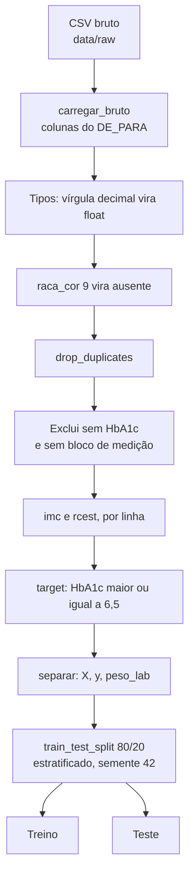
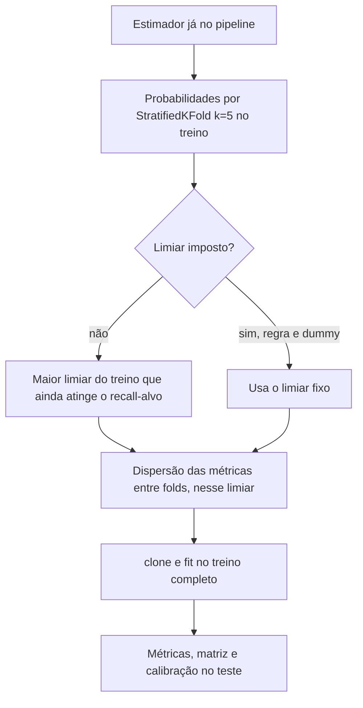
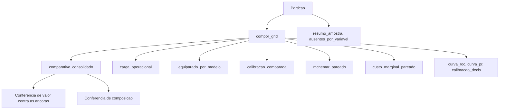
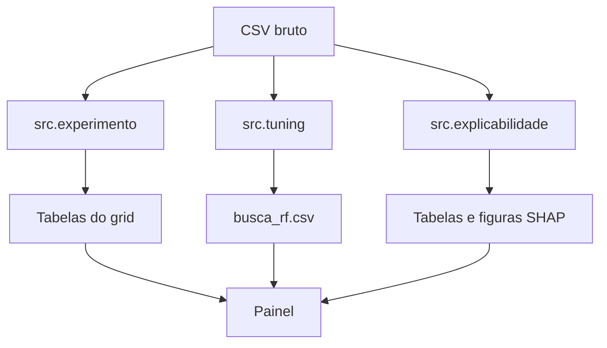
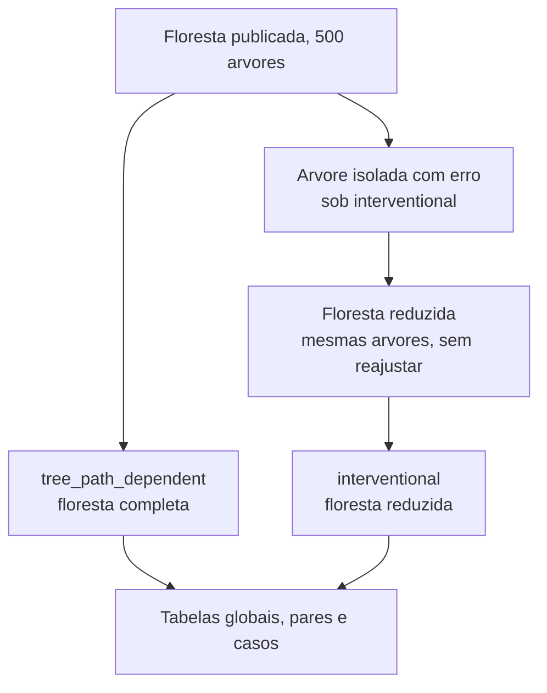
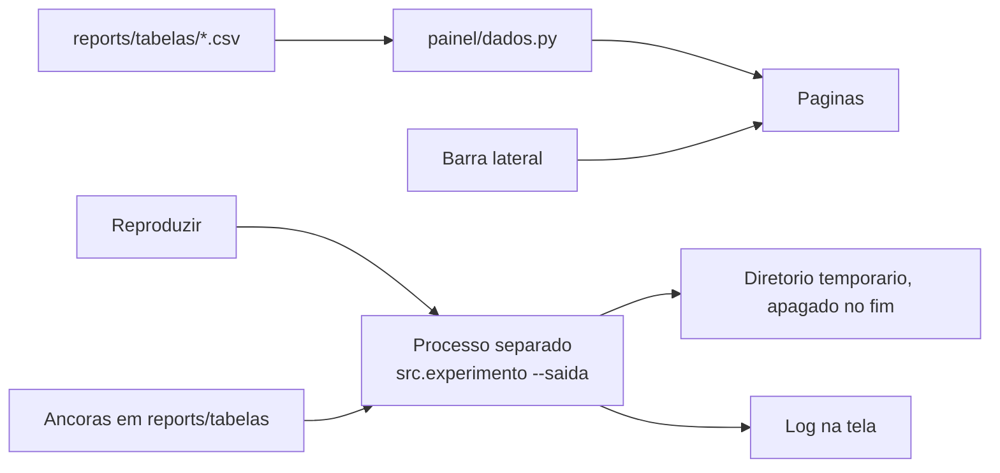

# Arquitetura

Três superfícies, com papéis que não se misturam.

`src/` calcula. `notebooks/03_resultados.ipynb` chama `src/` na ordem da arguição
e é commitado com outputs, porque é dele que saem as figuras do texto. `painel/`
lê `reports/tabelas/*.csv` e não importa `src/`. A única exceção de execução é a
página de reprodução ao vivo, que dispara `python -m src.experimento` num
processo separado e apaga o diretório temporário no fim.

Constantes, caminhos, o de-para dos códigos da PNS, os cortes clínicos e a semente
moram em `src/config.py`. Valor usado por mais de um módulo não é copiado para
dentro de um notebook.

## Mapa

```
src/config.py            constantes, DE_PARA, cortes, semente, caminhos
src/data.py              carga e limpeza, uma linha por vez
src/features.py          conjuntos, imputação, compostas, preprocessador
src/colinearidade.py     Pearson, VIF, ablação, decomposição do escore
src/models.py            logística, floresta e o embrulho do grid
src/benchmark.py         regra clínica ADA e classificador da classe majoritária
src/evaluate.py          limiar, métricas, calibração, McNemar, figuras
src/experimento.py       grid publicado, artefatos, conferência. CLI
src/tuning.py            busca da floresta. CLI, fora do grid
src/explicabilidade.py   SHAP da floresta publicada. CLI, fora do grid
src/artefatos.py         gravação de CSV, sem depender do resto de src/

notebooks/03_resultados.ipynb
painel/                  doze páginas em três seções
reports/tabelas/         .csv e .tex versionados
reports/figuras/         PNG gerado, fora do Git, salvo o .gitkeep
docs/baseline/           notebook da primeira matriz, congelado
tests/                   contrato de forma, prevalência e reprodução
```

Nomes de variável no código seguem o `DE_PARA`. O código cru da PNS não vaza
para modelo, tabela ou tela.

## Do CSV ao split

Nada que olhe mais de uma linha roda antes da divisão. Imputação não mora em
`data.py`.



`carregar_bruto` lê com `dtype=str`. A conversão fica inteira em `limpar`, nesta
ordem: tipos, código ignorado de raça/cor, duplicatas, exclusões, derivadas,
binarização do desfecho. As contagens de exclusão ficam em `df.attrs["exclusoes"]`
no momento do corte.

O bloco de medição é peso, altura, cintura, PAS e PAD. Sai quem não tem nenhuma
dessas medidas, e essa contagem não se sobrepõe a quem já saiu por falta de HbA1c.

O contrato atual da amostra analítica está em `tests/test_data.py`: 8.451 linhas,
prevalência do desfecho 7,02% com tolerância de 0,1 ponto percentual, ausentes
remanescentes só em `colesterol_alto` (1.297), `has_autorrelato` (261), `regiao`
(4) e `raca_cor` (2). Contínuas saem sem ausente. Idade vai de 18 a 101. Mudar
esses números é decisão sobre a amostra, não ajuste de teste.

`peso_lab` volta separado de `X`. Ele pondera a descrição da amostra. Nenhum
estimador o recebe. A prevalência que contextualiza as métricas é a amostral.
A ponderada é estimativa populacional e aparece só na descrição.

## Preprocessador

As compostas dependem de variáveis já imputadas, e a imputação aprende só no
treino. Por isso `imc` e `rcest` nascem na limpeza, por linha, e o restante das
derivadas nasce dentro do `Pipeline`, depois do split.


`construir_preprocessador` monta esses três estágios. A seleção do conjunto fica
no último, com `remainder="drop"`. Os dois primeiros precisam de todas as
preditoras, inclusive as que o conjunto escolhido não usa como coluna. O conjunto
B, por exemplo, não leva `has_autorrelato` como coluna e ainda assim o escore de
multimorbidade precisa dela imputada.

### Espaço do KNN

O vizinho é distância euclidiana. Em escala bruta, PAS e cintura dominam a
vizinhança e `rcest` não muda a ordem. O espaço métrico usa as contínuas
padronizadas por um `StandardScaler` interno, ajustado no treino, mais `sexo_fem`
em 0/1. Nominais e ordinais são alvo da imputação e não votam na distância:
código de região não é quantidade. Depois de imputar, `inverse_transform` devolve
as contínuas à unidade clínica, porque os cortes de IMC e cintura estão em
unidade real. Quem padroniza para o modelo é o `StandardScaler` do
`ColumnTransformer`, outro objeto.

Categórica imputada passa por `KNNImputerCategorico`: arredonda para o inteiro
mais próximo e corta nos códigos vistos no treino. Sem isso, `raca_cor` sairia
2,7 e o one-hot quebraria. Tratar ausência como categoria própria é variante
prevista para `colesterol_alto` e não está implementada. O padrão é o KNN.

Cinco vizinhos, peso pela distância.

### Compostas

`ConstrutorCompostas` não aprende parâmetro. Ainda assim é estágio de pipeline:
construir o escore antes do split faria o teste carregar imputação ajustada na
base inteira.

- `sexo_fem`, `plano_sim`, `colesterol_sim`: recodificação binária.
- `has_combinada`: PAS ≥ 140 ou PAD ≥ 90, ou autorrelato afirmativo. O código de
  hipertensão só na gravidez não entra.
- `multimorbidade`: escore de 0 a 3. Soma hipertensão combinada, colesterol alto
  e obesidade. Obesidade é IMC ≥ 30 ou cintura ≥ 80 cm em mulher ou ≥ 94 cm em
  homem.

`raca_cor` entra como marcador de determinação social e de acesso a serviço.
Não é variável biológica. O agrupamento em faixas mais grossas não está no código.

## Conjuntos de atributos

Definidos em `features.FEATURE_SETS`. A chave `FONTES` diz qual variável crua
alimenta cada coluna. Os testes de `tests/test_features.py` usam isso para
cobrar ortogonalidade.

| Conjunto | O que entra | Papel |
|---|---|---|
| `A_atomico` | Componentes, sem escore agregado | Leitura mais limpa do SHAP |
| `B_composto` | `multimorbidade` no lugar de pressão e dos diagnósticos que o escore já soma | Testa o escore como substituto |
| `C_completo` | Componentes e compostas juntos, com `rcest` | Mede o custo da redundância |

A e B não repetem a mesma informação por dois canais idênticos. C repete de
propósito: `has_autorrelato` e `colesterol_alto` aparecem como coluna e de novo
dentro do escore. Sobreposição por corte clínico (IMC contínuo e o mesmo IMC
binarizado dentro da obesidade do escore) é admitida. O tamanho dela se mede
pelo VIF.

A floresta publica só em A e B. C foi descartado pelo diagnóstico de
colinearidade, e publicar desempenho de conjunto descartado finge que ele ainda
está em disputa. A logística continua nos três: a linha de C é o número que
sustenta o descarte. `rcest` sai de A e de B pelo mesmo diagnóstico: VIF acima
de 10, no limiar de `config.VIF_LIMIAR`, com Pearson alto frente à cintura. A
ablação que tira `rcest` e recalcula o VIF está em `colinearidade.ablacao_vif`.
O conjunto derivado não entra em `FEATURE_SETS`.

O one-hot usa `drop="first"`. A categoria de referência tem atribuição zero por
construção. Isso aparece na tabela de SHAP por coluna, não como irrelevância.

## Uma célula do grid

`models.montar` embrulha logística e floresta no preprocessador. A regra ADA e o
dummy saem crus: o corte de IMC 30 não sobrevive a uma padronização, e o dummy
ignora `X`. Os dois declaram `invariante_ao_conjunto` e rodam uma vez, com
conjunto ausente na tabela. Rodá-los em A, B e C repetiria a mesma linha.



O recall-alvo mora em `config.RECALL_ALVO` (0,80) e está marcado no código como
provisório. O teste não escolhe limiar. Entre os limiares do treino que atingem
o alvo, fica o maior: mesmo recall, menos encaminhamento. Recall é a métrica
prioritária. Especificidade, F1 e AUC-ROC acompanham em toda tabela. PR-AUC,
Brier e NNS entram junto.

A regra clínica é idade ≥ 45 ou IMC ≥ 30. O dummy prevê a classe majoritária.
Os dois devolvem 0 ou 1, então não há curva para calibrar limiar. Métrica que
depende de curva, neles, não se compara com a dos modelos.

Critério de sucesso frente à regra: recall maior e NNS menor, no regime em que
o limiar do modelo mira o recall que a regra obteve no treino. Volume absoluto
de encaminhamento só se compara entre estratégias no mesmo recall. Há uma guarda
em `xfail` estrito porque a floresta em `B_composto`, nesse regime, deixa de
cumprir o critério. A asserção permanece. Se uma execução futura passar, a suíte
acusa. Não afrouxe o teste para ele ficar verde.

Hiperparâmetros da floresta, copiados do vencedor da busca em `B_composto` e
aplicados também a `A_atomico`:

```
class_weight = balanced_subsample
n_estimators = 500
max_depth = 10
min_samples_leaf = 20
max_features = sqrt
random_state = 42
```

`balanced_subsample` recalcula o peso dentro de cada amostra bootstrap.
`balanced`, o da logística, pesa pelo treino inteiro. Os dois são aprendizado
sensível ao custo. A busca comparou os dois. `n_estimators` ficou fora do
espaço, fixo em 500. `min_samples_leaf` tem piso 5 no espaço da busca: folha
unitária degenera a curva precision-recall e estraga o limiar que vem depois.

O literal em `models.random_forest` é a configuração publicada. Ler o vencedor
do CSV em tempo de execução faria o modelo depender de um arquivo que não é
código. `tests/test_tuning.py` confere literal e artefato.

## O que `src.experimento` emite

`preparar_particao` faz carga, limpeza e split. `compor_grid` monta o produto
que a tabela publica: logística nos três conjuntos, floresta em A e B, regra e
dummy uma vez cada. Sete linhas.



Duas conferências, dois defeitos. A de reprodução compara valores na interseção
dos índices com `comparativo_logreg.tex` e `comparativo_rf.tex`, na terceira
casa. A da logística também mostra que a entrada da floresta não moveu número
dela. A de composição acusa célula ausente ou inesperada. Sem a segunda, uma
tabela truncada passa com todos os números certos.

`--saida DIR` grava tabelas e figuras em outro diretório e continua conferindo
contra as âncoras de `reports/tabelas/`. É o modo da reprodução ao vivo.
`--congelar-ancora` regrava a âncora da floresta a partir da execução corrente
e não combina com `--saida`. `--figuras` salva matriz, ROC, precision-recall e
calibração. `--sem-conferencia` existe para depuração.

A carga operacional traz três regimes da célula de referência, eleita pelo menor
NNS no ponto padrão: a regra ADA, o modelo com recall equiparado ao da regra no
treino, e o mesmo modelo no ponto padrão. `equiparado_por_modelo` repete o regime
equiparado para cada célula calibrável, porque a carga só detalha a referência.
O custo marginal compara floresta menos logística, por conjunto e regime.
O McNemar compara os dois modelos em `B_composto`, cada um no seu limiar.

Pearson, VIF e SHAP não saem deste comando. Pearson e VIF saem do notebook,
chamando `src/colinearidade.py`. SHAP sai de `python -m src.explicabilidade`.

## Busca e explicabilidade

Os dois ficam fora de `make resultados` porque são caros e nenhum número do grid
depende de reexecutá-los para a conferência das âncoras.



A busca cruza `RandomizedSearchCV` no pipeline inteiro, com cache de
transformador fora do repositório. Cache existe para o KNN não refitar a cada
candidato. A validação interna refaz imputação, escala e codificação em cada
fold. Transformar a base uma vez e só então cruzar folds vazaria o teste do
fold para o imputador. A métrica da busca é average precision. Paralelismo em
um nível: a busca usa os núcleos, a árvore da busca usa um. Os mesmos candidatos
caem em A e em B, para o vencedor de B aparecer medido também em A.

O módulo de SHAP não treina outro modelo, não calibra outro limiar e não mede
desempenho. Usa `models.random_forest`, o preprocessador de `features` e o
limiar de `evaluate.avaliar`, conferido contra `comparativo_consolidado.csv`
antes de explicar. Se divergir, para.



O regime principal é o que vai ao texto. O de contraste assume independência
entre colunas e mede o quanto o ranking depende dessa hipótese. A floresta
reduzida é diagnóstico: o explicador erra em algumas árvores sob
`interventional`, e as mesmas árvores fecham no regime principal. Ela não é
modelo publicado. Reajustar produziria outra floresta.

As atribuições ficam na escala do escore, a mesma do limiar. A soma reconstrói
o escore da pessoa, não um risco. O valor de base fica perto de 0,5 por efeito
do `class_weight`, não perto da prevalência. Contribuição negativa não é efeito
protetor: a referência é o indivíduo médio sob reponderação de classes.
Probabilidade do modelo é escore de ordenação. 0,60 não é chance de 60%.

Casos locais: um verdadeiro positivo, um falso positivo, um falso negativo e um
verdadeiro negativo por célula, cada um o mais perto do limiar na sua célula da
matriz. `LinearExplainer` da logística não roda.

## Painel

Sobe sem rede (`.streamlit/config.toml` escuta só localhost e desliga telemetria).
`painel/dados.py` é o único módulo que abre arquivo. Cada artefato declara as
colunas que as telas usam. Coluna a mais no CSV passa. Coluna declarada ausente
falha nomeando o artefato. As telas chamam `dados.carregar`. Cor hexadecimal só
em `painel/estilo.py`. Frase fixa em `painel/textos.py`. Número de resultado não
mora em frase: sai de coluna. A barra lateral escolhe a célula em
`painel/selecao.py`. Nenhuma página escreve o nome da célula como literal.



Antes do botão, a página tenta `import src.experimento` com o mesmo
interpretador, num processo filho. O painel continua sem importar sklearn.
Se o import falha, a tela mostra o interpretador em uso e o comando da `.venv`,
em vez de um traceback no meio do log. O selo final sai do código de saída do
processo. `reports/tabelas/` não é regravado.

| Seção | Páginas |
|---|---|
| Projeto | Visão geral, Reprodução ao vivo |
| Visão clínica e de gestão | Desempenho, Triagem na atenção primária, Fatores associados, Casos exemplares |
| Visão técnica | Amostra, Colinearidade e escolha do conjunto, Modelagem, Floresta × logística, Calibração, Explicabilidade técnica |

A visão geral desenha o funil, o desbalanceamento, o pipeline, a comparação
entre reamostragem sintética e aprendizado sensível ao custo, as fases do
CRISP-DM e o que o sistema não faz: não classifica paciente novo, não estima
risco individual, não elege célula principal. A implantação com API e formulário
de classificação individual não é este painel.

A célula abre na de menor NNS no ponto padrão, identificada como referência.
Os dois regimes de operação aparecem lado a lado. Prints das telas estão em
`docs/prints_prebanca/`.

## Linguagem

Saída, título de figura, docstring e texto de tela falam em associação e em
perfil associado. O desenho é transversal. "Risco de desenvolver" e "modelo
preditivo" não entram. `tests/test_painel.py` varre as páginas, inclusive o
HTML, atrás de vocabulário fora dessa regra.
